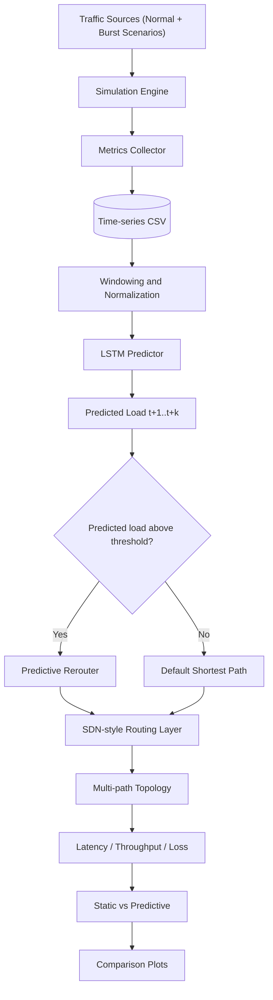
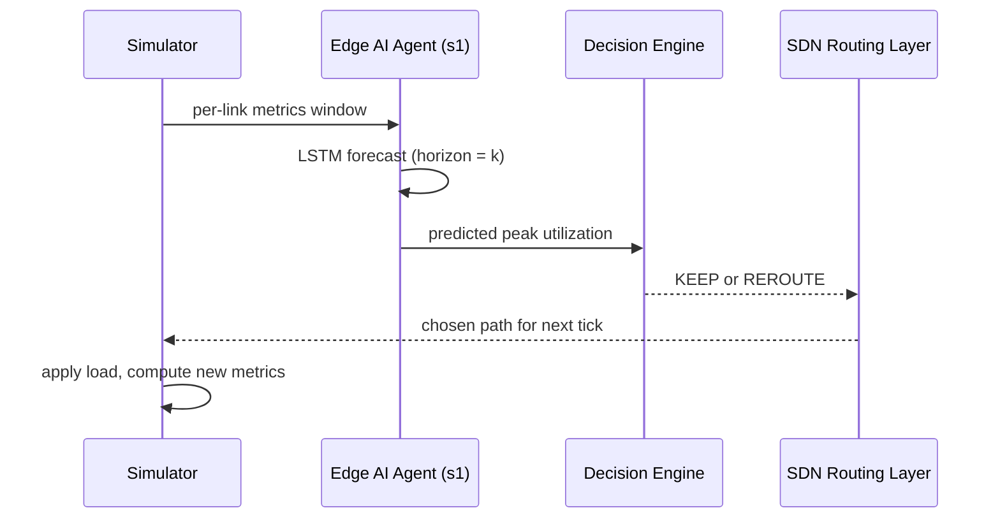

# Architecture

## Component diagram



## Network topology

A deliberately small multipath topology, chosen so the impact of the
predictive policy is unambiguous:

```
h1 -- s1 ============ s2 -- h2
          \\                 //
           \\---- s3 -------//
```

- Primary path `h1 - s1 - s2 - h2`: low-latency, narrow capacity (bottleneck).
- Alternate path `h1 - s1 - s3 - s2 - h2`: slightly higher base latency but
  independent capacity, used as a relief valve when the primary path is
  predicted to congest.
- Link capacities, base latencies, and burst windows are declared in
  [`src/config.py`](../src/config.py).

## Edge intelligence framing

The forecaster and decision engine are described as a **logical edge agent**
co-located with the source-side switch `s1`. Concretely this means:

- The metrics collector only consumes signals reachable at `s1`.
- The LSTM inference and decision step complete inside one simulation tick
  (sub-second order).
- No cloud round-trip is on the critical path.

This mirrors how a 6G-era edge-native control plane is expected to operate:
intelligence is distributed into the network fabric rather than centralised.

## Module map

| Layer            | Module                                                                                    | Responsibility                                                                                  |
|------------------|-------------------------------------------------------------------------------------------|-------------------------------------------------------------------------------------------------|
| Config           | [`src/config.py`](../src/config.py)                                                       | Single source of truth for all knobs                                                            |
| Topology         | [`src/simulation/topology.py`](../src/simulation/topology.py)                             | NetworkX graph builder; path enumeration                                                        |
| Traffic          | [`src/simulation/traffic_generator.py`](../src/simulation/traffic_generator.py)           | Normal / burst / mixed scenarios                                                                |
| Simulator        | [`src/simulation/simulator.py`](../src/simulation/simulator.py)                           | Discrete-time fluid model; emits per-link `TickRecord`s                                         |
| Data             | [`src/data/collector.py`](../src/data/collector.py)                                       | `TickRecord` -> tidy DataFrame -> CSV                                                           |
| Preprocess       | [`src/data/preprocessor.py`](../src/data/preprocessor.py)                                 | Sliding-window + MinMax scaling                                                                 |
| ML model         | [`src/ml/lstm_model.py`](../src/ml/lstm_model.py)                                         | Two-layer LSTM + Dense head                                                                     |
| ML train         | [`src/ml/train.py`](../src/ml/train.py)                                                   | Fit on training CSV; persist model + scalers + metadata                                         |
| ML predict       | [`src/ml/predict.py`](../src/ml/predict.py)                                               | Load artifacts; per-link forecast; congestion flag                                              |
| Decision         | [`src/decision/engine.py`](../src/decision/engine.py)                                     | Threshold + hysteresis rule                                                                     |
| Routers          | [`src/sdn/router_static.py`](../src/sdn/router_static.py), [`router_predictive.py`](../src/sdn/router_predictive.py) | Static shortest-path baseline; AI-driven predictive rerouter                                    |
| Evaluation       | [`src/evaluation/metrics.py`](../src/evaluation/metrics.py), [`compare.py`](../src/evaluation/compare.py) | Per-experiment summaries; static-vs-predictive deltas                                           |
| Visualization    | [`src/visualization/plots.py`](../src/visualization/plots.py)                             | Latency/throughput/utilization timeseries, summary bars                                         |
| Pipeline         | [`scripts/run_all.py`](../scripts/run_all.py)                                             | End-to-end driver                                                                               |
| Stretch (Track B)| [`mininet/`](../mininet/)                                                                 | Real OpenFlow data plane reusing the same schema                                                |

## Control loop (per tick)


